# Databáze dostupných desek a modulů

Mechanické a elektrické údaje modulů, které jsou k dispozici, pro návrh krabiček a zapojení dalších projektů. Každý modul má vlastní podsložku s fotografiemi, datasheety a ukázkovým kódem. Stav k 2026-11-06.

Původ rozměrů je značen písmenem: **M** – změřeno posuvkou, **V** – údaj výrobce/prodejce, **O** – odečteno z kótovaného obrázku nebo výkresu ve složce. Rozměr desky je uváděn š × v (delší strana podle orientace na fotografii), bez přečnívajících konektorů, není-li uvedeno jinak. Výška (osa z) chybí u většiny modulů – viz [Co chybí](#co-chybí).

## Přehled

| Modul | Složka | Rozhraní | Napájení | Deska [mm] | Díry Ø [mm] | Rozteč děr [mm] | Použito |
|---|---|---|---|---|---|---|---|
| [Arduino Nano V3 (USB-C, CH340)](#arduino-nano-v3-usb-c-ch340) | – | – | 5 V USB / 7–12 V VIN | 18 × 45 V | – | – | AS7262, AS7341 |
| [Arduino Pro Micro (ATmega32U4)](#arduino-pro-micro-atmega32u4) | [arduino_pro_micro](arduino_pro_micro/) | – | 5 V / 16 MHz | 18,5 × 35 M | nemá | – | – |
| [ESP32 DevKit CP2102 USB-C](#esp32-devkit-cp2102-usb-c) | [esp32_devkit_cp2102](esp32_devkit_cp2102/) | – | 5 V USB | 28 × 52 M (53,5 s USB) | 4× 3 | 23,5 × 46,5 M | – |
| [ESP32 Wemos D1 R32](#esp32-wemos-d1-r32) | [esp32_wemos_d1_r32](esp32_wemos_d1_r32/) | – | 5–12 V | 68 × 53,5 M | 4× (rozložení UNO) | viz sekce | – |
| [AS7341 (GY)](#as7341-spektrální-senzor-gy) | [as7341](as7341/) | I2C 0x39 | 3,3–5 V | 21,03 × 12,87 O | 2× 2 | 15,54 O | AS7341 |
| [AS7262 SparkFun Qwiic](#as7262-spektrální-senzor-sparkfun-qwiic) | [as7262](as7262/) | I2C 0x49 / UART | 3,3 V | 25,4 × 25,4 O | 2× 3,3 | 20,32 O | AS7262 |
| [BH1750 (GY-302)](#bh1750-gy-302-luxmetr) | [bh1750](bh1750/) | I2C 0x23 / 0x5C | 3–5 V | 14 × 19 M | 2× 3 | ~8 M | AS7262, HA luxmetr |
| [OLED 0,96" 128×64](#oled-096-12864-ssd1306) | [oled_096](oled_096/) | I2C 0x3C | 3,3–5 V | 27 × 27,1 O | 4× 3 | 21 × 23 M | – |
| [OLED 1,3" 128×64 SH1106](#oled-13-12864-sh1106) | [oled_130_sh1106](oled_130_sh1106/) | I2C 0x3C | 3,3–5 V | 36 × 34 M | 4× 3 | 30,5 × 28 M | AS7262 |
| [TFT 2,8" IPS 240×320 dotykový](#tft-28-ips-240320-kapacitní-dotyk) | [tft_28_ips_touch](tft_28_ips_touch/) | SPI + I2C (CTP) | 5 V (logika 3,3–5 V) | 86 × 50 M | 4× 3 | 76 × 44 M | NES handheld (plán) |
| [DS18B20 sonda 100 cm](#ds18b20-sonda-100-cm-my18e20) | [ds18b20_sonda](ds18b20_sonda/) | 1-Wire | 3–5,5 V | Ø 6 × 50 (pouzdro) V | – | – | – |
| [SHT31-D (GY)](#sht31-d-gy-teplota-a-vlhkost) | [sht31](sht31/) | I2C 0x44 / 0x45 | 2,4–5,5 V | ? (12 × 10 × 4 V je čip?) | 1× 3 | roh 2,5 / 2,5 M | – |
| [AHT20 + BMP280](#aht20--bmp280-teplota-vlhkost-tlak) | [aht20_bmp280](aht20_bmp280/) | I2C 0x38 + 0x76/0x77 | 3,3–5 V | 15 × 15 M | 2× 2 | 11 M | – |
| [ML8511 UV](#ml8511-uv-senzor) | [ml8511_uv](ml8511_uv/) | analog 1–3 V | 2,7–3,6 V | 13 × 11 V | 1× 3 | roh 2,5 / 2,5 M | – |
| [MPU-6050](#mpu-6050-gyroskop--akcelerometr) | [mpu6050](mpu6050/) | I2C 0x68 / 0x69 | 3–5 V | 21 × 15 × 1,2 V | 2× 3 | 15 M | – |
| [INA228](#ina228-monitor-napětí-proudu-a-výkonu) | [ina228](ina228/) | I2C 0x40–0x4F | 2,7–5,5 V | ? | 3 (montážní) | ? | – |
| [GPS GY-NEO6MV2](#gps-gy-neo6mv2) | [gps_neo6m](gps_neo6m/) | UART | 3,3–5 V | 36 × 27 M | 4× 3 | 31 × 23 M | – |
| [TP4056 nabíječka USB-C](#tp4056-nabíječka-li-ion-usb-c) | [tp4056_nabijecka](tp4056_nabijecka/) | – | 4,5–6 V | 25 × 16,5 V (28 × 17,3 O) | 4× 1,5 | 23 × 14 M | – |
| [MT3608 step-up](#mt3608-step-up-2-a) | [mt3608_stepup](mt3608_stepup/) | – | 2–24 V | 36 × 17 × 14 V | 4× 1,5 (pájecí) | 34 × 6,4 M | – |
| [LM2596 step-down](#lm2596-step-down-3-a) | [lm2596_stepdown](lm2596_stepdown/) | – | 4,5–35 V | 40 × 21,5 × 13,5 V | 2× 3 | 33,5 M | – |
| [Držák 18650](#držák-článku-18650-s-vývody) | [drzak_18650](drzak_18650/) | – | – | 76 × 21 × 21 V | ? | ? | – |
| [Pájecí pole (část)](#pájecí-pole-část-58--70) | [pajeci_pole_58x70](pajeci_pole_58x70/) | – | – | 58 × 70 M | 2× 3 | 65 M | – |
| [Tlačítka 1×4 malá](#tlačítka-14-malá) | [tlacitka_1x4_maly](tlacitka_1x4_maly/) | digitální 4× | – | 37,7 × 16 O | 4× 3 | 33 × 11 M | – |
| [Tlačítka 1×4 analogová](#tlačítka-14-analogová-barevná) | [tlacitka_1x4_analog](tlacitka_1x4_analog/) | analog 1 pin (PH2.0) | 3,3–5,5 V | 77 × 18 × 14 V | 3 | 62 × 10 M | – |
| [Tlačítka 2×2 matice](#tlačítka-22-matice-keypad-22-v100) | [tlacitka_2x2](tlacitka_2x2/) | matice 2×2 (4 piny) | – | 25 × 20 M | 4× ? | 14 × 19 M | – |
| [Joystick 5směrný](#joystick-5směrný--set--rst) | [joystick_5smer](joystick_5smer/) | digitální 7× | 2–9 V? | 25 × 41 M | 4× 4 | 18 × 24 M | – |

Pozn. k I2C adresám: obsazení sběrnice před návrhem zkontrolovat v tabulce níže. Konflikt hrozí u modulů s pevnou adresou (AS7262 0x49, AS7341 0x39, AHT20 0x38) při dvou kusech téhož typu – nutný multiplexer (TCA9548A).

### I2C adresy

| Adresa (7 bit) | Modul | Volba |
|---|---|---|
| 0x23 / 0x5C | BH1750 | pin ADDR (L / H) |
| 0x38 | AHT20 | pevná |
| 0x39 | AS7341 | pevná |
| 0x3C / 0x3D | OLED 0,96" a 1,3" | rezistor na desce (0x78/0x7A v 8bit zápisu na potisku) |
| 0x40–0x4F | INA228 | A0, A1 (16 kombinací) |
| 0x44 / 0x45 | SHT31 | pin ADR |
| 0x49 | AS7262 | pevná |
| 0x68 / 0x69 | MPU-6050 | pin AD0 |
| 0x76 / 0x77 | BMP280 | SDO |

---

## Řídicí desky

Arduino desek bylo koupeno více typů (Nano, Pro Micro, varianty USB-C/micro-USB, 5 V/3,3 V) a přiřazení kusů není jisté. Údaje níže jsou orientační; u konkrétního projektu typ desky ověřit podle potisku a čipu (ATmega328P = Nano, ATmega32U4 = Pro Micro).

### Arduino Nano V3 (USB-C, CH340)

Použit v obou stávajících projektech (ATmega328P). Odkaz: [dratek.cz](https://dratek.cz/arduino-platforma/121745-usb-c-klon-arduino-nano-ch340.html).

- Deska: 18 × 45 mm V (rozměr originálního Nana; klon s USB-C neměřen).
- Montážní díry: neověřeno.
- Fotografie, složka a pinout chybí (dodané snímky jsou Pro Micro).

### Arduino Pro Micro (ATmega32U4)

Verze USB-C, 5 V/16 MHz (prodává se i 3,3 V/8 MHz), kompatibilní s Leonardo (nativní USB HID). Odkaz: [AliExpress](https://www.aliexpress.com/item/1576902211.html).

| Parametr | Hodnota |
|---|---|
| Deska | 18,5 × 35 mm M |
| Montážní díry | nemá; upevnění za lištu kolíků nebo drážkou |
| Kolíky | 2 × 12, rozteč 2,54 mm |
| Levá řada (USB nahoře) | TXO, RXI, GND, GND, 2, 3, 4, 5, 6, 7, 8, 9 |
| Pravá řada | RAW, GND, RST, VCC, A3, A2, A1, A0, 15, 14, 16, 10 |
| Napětí | pájecí propojka 5V / 3.3V na spodní straně |

Fotografie i pinout odpovídají Pro Micro podle potisku; zda jde o tentýž kus, který byl měřen (18,5 × 35 mm), a o jakou napěťovou verzi, je nepotvrzeno. Pinout opsán z potisku na fotografii. I2C je na pinech 2 (SDA) a 3 (SCL), SPI na 14 (MISO), 15 (SCK), 16 (MOSI) – standard ATmega32U4/Leonardo, na desce neověřeno.

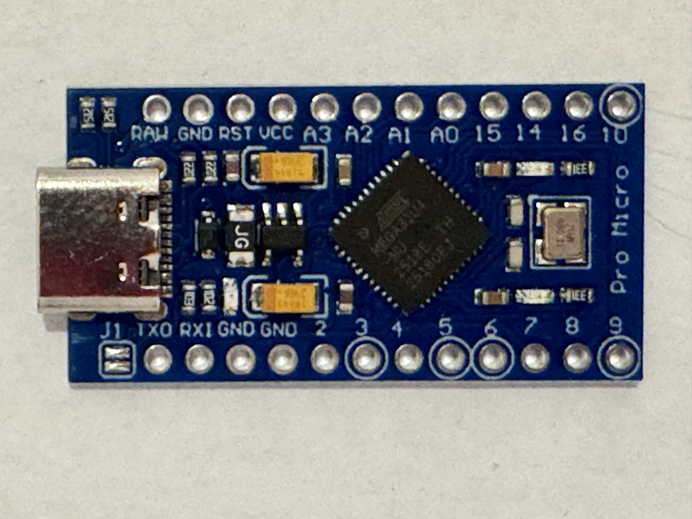 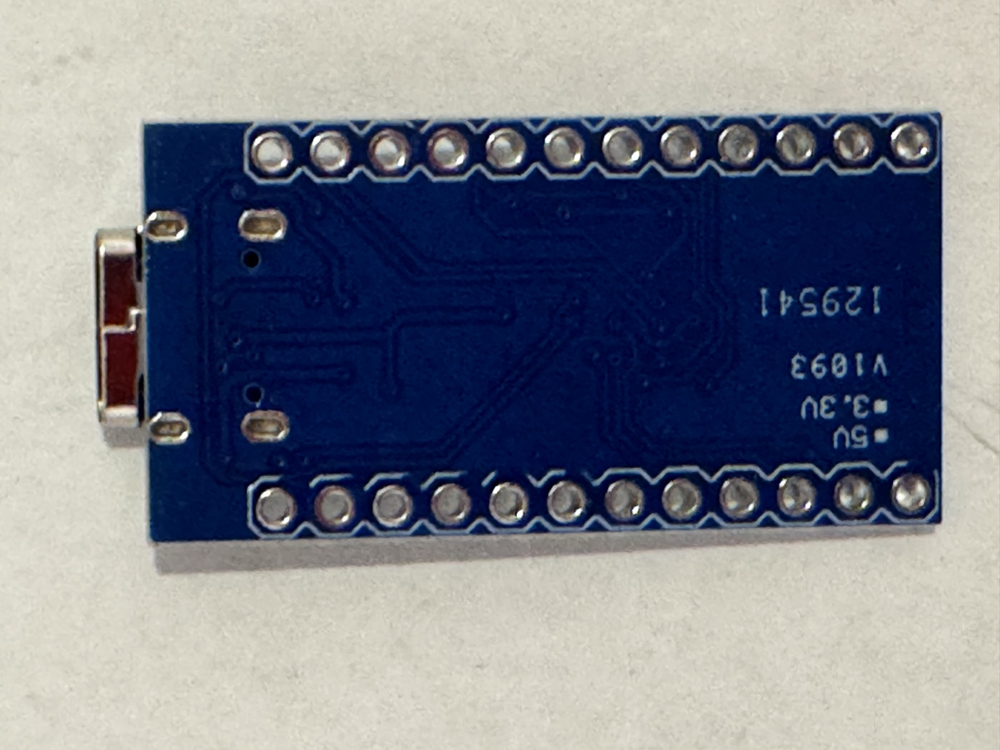

### ESP32 DevKit CP2102 USB-C

ESP32-WROOM (ESP-32S), převodník CP2102. Odkaz: [AliExpress](https://www.aliexpress.com/item/1005006882009703.html).

| Parametr | Hodnota |
|---|---|
| Deska | 28 × 52 mm M, 53,5 mm včetně přečnívajícího USB-C |
| Díry | 4× Ø 3 mm, rozteč 23,5 × 46,5 mm M |

### ESP32 Wemos D1 R32

ESP-WROOM-32 ve formátu Arduino UNO, CH340, micro-USB, napájecí konektor 5–12 V, 4 MB flash; analogový vstup max. 3,2 V. Odkaz: [dratek.cz](https://dratek.cz/arduino-platforma/2170-esp32-vyvojova-deska-wifi-bluetooth-4mb-flash-uno-r3-d1-ch340-r32.html).

| Parametr | Hodnota |
|---|---|
| Deska | 68 × 53,5 mm M |
| Díry (M) | rozteč 48 a 28 mm, excentricky, vzdálenost ~50,5 mm |
| Díry (UNO R3, referenční) | souřadnice od levého dolního rohu: (13,97; 2,54), (15,24; 50,80), (66,04; 7,62), (66,04; 35,56) mm |

Naměřené rozteče odpovídají rozložení UNO (28 mm = 35,56 − 7,62; 50,8 mm = 66,04 − 15,24). Souřadnice UNO jsou z výkresu Arduino UNO Rev3 a na této desce nebyly přeměřeny.

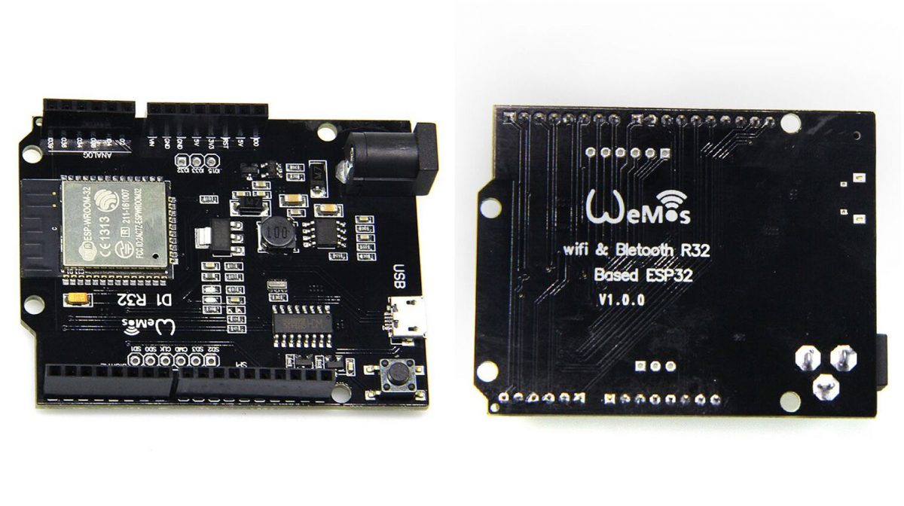

---

## Senzory světla

### AS7341 spektrální senzor (GY)

11 kanálů (8 VIS + Clear + NIR + flicker), modul GY s bílou LED. Prodáván jako „GY-AS7262 AS7263 AS7341"; registry potvrzen AS7341 (WHOAMI 0x92), viz [projekt AS7341](../arduino_nano_spectrophotometerAS7341/README.md). Odkaz: [AliExpress](https://www.aliexpress.com/item/1005003600257080.html).

| Parametr | Hodnota |
|---|---|
| Deska | 21,032 × 12,874 mm O |
| Díry | 2× Ø 2 mm, rozteč 15,536 mm O |
| Střed děr od horního okraje | 4,978 mm |
| Piny | VIN, GND, SCL, SDA (rozteč 2,54); I, G (INT, GPIO) |
| I2C | 0x39 |
| Zorný úhel čipu | poloviční kužel 40° (datasheet, Fig. 16) – pro návrh clony a difuzoru |

Soubory: [datasheet DS000504](as7341/as7341_datasheet_DS000504.pdf), [kótovaný výkres](as7341/as7341_pinout.avif).

  

**Digitalizovaná spektrální citlivost** ([responsivity_fig18/](as7341/responsivity_fig18/)): Figure 18 datasheetu („Measured Spectral Responsivity Relative to F8"), F1–F8 při AGAIN 256×, Clear 512×, NIR a Flicker 64× (gain podle popisu v grafu), difuzor na pouzdře; osa y relativně k maximu F8, CSV `x` = nm, `y` = relativní citlivost, 8–29 bodů na křivku. Digitalizována je jen část křivky nad nulou; mimo rozsah bodů v CSV je citlivost blízká nule. Pro Clear, NIR a Flicker není z grafu jasné, zda je y přepočteno na gain F kanálů; pro srovnání s F1–F8 s tím počítat. Kontrola proti tabulkám Fig. 7–14 (FWHM a střed FWHM interpolací z CSV):

| Kanál | Body | Střed FWHM CSV [nm] | λp datasheet min–typ–max [nm] | FWHM CSV [nm] | FWHM datasheet [nm] |
|---|---|---|---|---|---|
| F1 | 8 | 416 | 405–415–425 | 25 | 26 |
| F2 | 10 | 443 | 435–445–455 | 29 | 30 |
| F3 | 16 | 474 | 470–480–490 | 36 | 36 |
| F4 | 19 | 512 | 505–515–525 | 39 | 39 |
| F5 | 26 | 550 | 545–555–565 | 37 | 39 |
| F6 | 27 | 585 | 580–590–600 | 39 | 40 |
| F7 | 26 | 621 | 620–630–640 | 49 | 50 |
| F8 | 24 | 672 | 670–680–690 | 50 | 52 |
| NIR | 20 | 907 | 910 (typ) | 102 | – |

FWHM sedí na 0–2 nm. Středy F3–F8 leží soustavně o 5–9 nm pod typickou hodnotou, ale v toleranci; posun může pocházet z kalibrace osy x při digitalizaci (doporučeno ověřit dvěma body osy, např. 400 a 900 nm). Křivky jsou typické pro jeden vzorek měřený výrobcem, ne pro tento kus.

Tabulky Fig. 7–14 stačí pro stávající kalibraci (jeden faktor Re na kanál při 2700K LED). Křivky přidávají tvar pásma a mimopásmové výběžky: F5 a F6 mají v oblasti 700–990 nm citlivost 1–3 % maxima F8 (2–4 % vlastního maxima F6). Pro jednotlivý pás je to málo, ale integrováno přes 300 nm u zdroje s velkým podílem NIR (halogen, denní světlo) to může být znatelné – tabulka to nepopisuje. Potřebné jsou pro přepočet na zdroj s jiným spektrem než 2700K LED, pro simulaci očekávaných countů a pro rekonstrukci spektra. K přepočtu na jiný zdroj slouží spektrum testovacích LED z Fig. 15:

**Digitalizovaná spektra testovacích LED** ([led_spectra_fig15/](as7341/led_spectra_fig15/)): Fig. 15 „Typical LED Spectra Used in Final Test", normalizováno na 1.

| Soubor | Použití v datasheetu | Body | Maximum [nm] | FWHM [nm] |
|---|---|---|---|---|
| [LED_Warm_white_2700.csv](as7341/led_spectra_fig15/LED_Warm_white_2700.csv) | Re F2–F8, Clear (107,67 µW/cm²) | 29 | 633 | 147 (od 549 nm) |
| [LED_420nm_plot-data.csv](as7341/led_spectra_fig15/LED_420nm_plot-data.csv) | Re F1 (57 µW/cm²) | 19 | 425 | 17 |
| [LED_940nm.csv](as7341/led_spectra_fig15/LED_940nm.csv) | NIR | 17 | 946 | 37 |

Naměřená srovnání světel (halogen, LED, denní světlo zatažené a jasné; AS7341, AS7262, luxmetr) jsou v [arduino_nano_spectrophotometerAS7341/tests.md](../arduino_nano_spectrophotometerAS7341/tests.md); zapracování do přepočtu je otevřené.

### AS7262 spektrální senzor (SparkFun Qwiic)

6 kanálů VIS: 450, 500, 550, 570, 600, 650 nm, FWHM 40 nm. Komunikace I2C (Qwiic konektory nebo piny dole) nebo UART s AT příkazy (piny nahoře). Adresa 0x49 je pevná; více kusů na jedné sběrnici vyžaduje multiplexer (Qwiic Mux). Na desce LED pro osvit vzorku a pady pro vlastní LED. Odkazy: [SparkFun](https://www.sparkfun.com/sparkfun-spectral-sensor-breakout-as7262-visible-qwiic.html), [návod a knihovna](https://learn.sparkfun.com/tutorials/as726x-nirvi).

Datasheet (Fig. 12): všechny kanály 45 counts/(µW/cm²) ±12 % při GAIN 16×, 166 ms, 3,3 V; přesnost vlnové délky ±5 nm, FWHM 40 nm, temné county max. 5 (GAIN 64×), zorné pole pouzdra ±20°. Testováno difuzním světlem, V–O 5700K bílou LED (~600 µW/cm²), R žárovkou (~1500 µW/cm²); energie kanálu = integrál ±40 nm kolem středu.

Normalizace Fig. 13 (každá křivka s maximem 1) je jen způsob zobrazení – skutečná citlivost kanálů se liší. Vyrovnání zajišťuje firmware čipu: vedle surových 16bit hodnot (registry 0x08–0x13, v knihovně SparkFun `getViolet()` …) poskytuje kalibrované hodnoty jako float (0x14–0x2B, `getCalibratedViolet()` …), přepočtené výrobními koeficienty uloženými v čipu na společnou škálu 45 counts/(µW/cm²) z Fig. 12. Algoritmus ani koeficienty datasheet neuvádí. Přepočet na irradianci tedy přibližně Ee [µW/cm²] ≈ Cal / 45 × (16 / GAIN) × (166 ms / t_int); platí pro zdroj podobný testovacímu (5700K LED, pro R žárovka), u jiných spekter je chyba větší než ±12 %. Spektrální křivky AS7262 digitalizovány nejsou. Firmware projektu `spectrometer_lightmeter_lightmeter_show-calibrated.ino` čte obojí.

Propojky: JP1 připojuje I2C pull-upy a volí I2C; pro UART JP1 rozpojit a JP2 (zadní strana) spojit. Při více zařízeních na sběrnici ponechat pull-upy jen na jednom. UART pouze s 3,3V převodníkem – 5 V modul poškodí.

| Parametr | Hodnota |
|---|---|
| Deska | 25,4 × 25,4 mm O (obrys v .brd) |
| Díry | 2× Ø 3,302 mm, rozteč 20,32 mm, středy 2,54 mm od horního a bočních okrajů O |
| Senzor | střed desky (12,7; 12,7) O |
| Piny | dole: I2C 4× (x = 19,05) a LED 2× (x = 8,89), 1,27 mm od spodního okraje; nahoře: FTDI/UART 6× (1,27 mm od horního okraje) O |
| Qwiic | 2× JST 1 mm, pravoúhlé, na levém a pravém okraji O |

Souřadnice od levého dolního rohu, strana s potiskem nahoře; .brd ověřen proti fotografii podle polohy děr, deska samotná přeměřena nebyla.

Soubory: [datasheet AS7262](as7262/as7262_datasheet.pdf), [schéma SparkFun](as7262/as7262_sparkfun_schema.pdf), Eagle [.brd](as7262/as7262_sparkfun_eagle.brd) / [.sch](as7262/as7262_sparkfun_eagle.sch). Knihovna SparkFun_AS726X je v [projektu AS7262/docs](../arduino_nano_lightmeterBH1750_spectrometerAS7262/docs/).

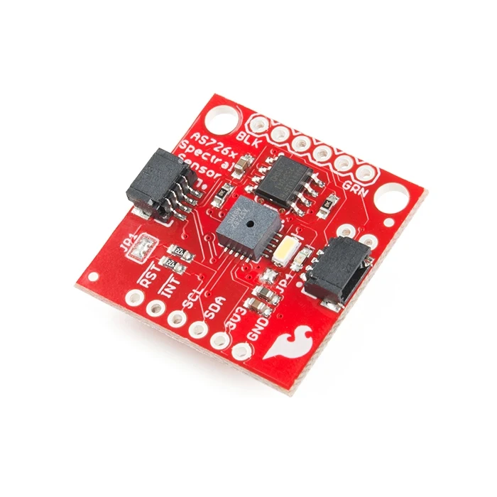 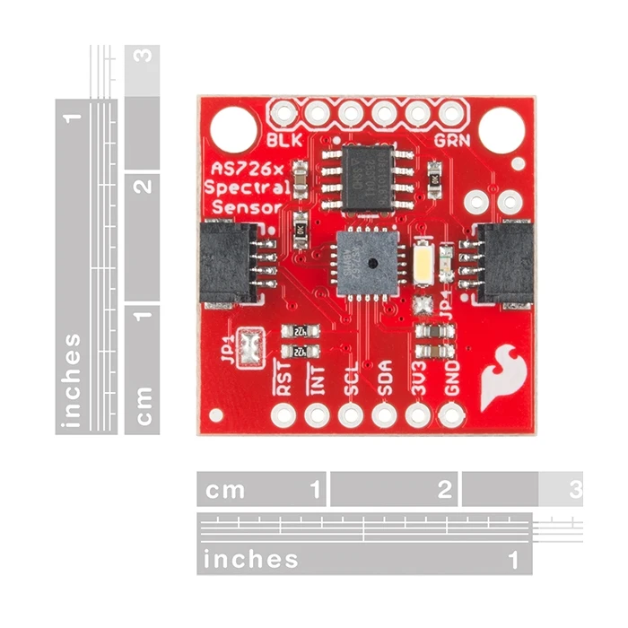

### BH1750 (GY-302) luxmetr

BH1750FVI, rozsah 1–65 535 lx, citlivost 1–4 lx, max. 190 µA. Použit v projektu [AS7262 + BH1750](../arduino_nano_lightmeterBH1750_spectrometerAS7262/) a v luxmetru pro Home Assistant (ESP32). Odkazy: [dratek.cz](https://dratek.cz/arduino-platforma/902-mereni-intenzity-svetla-bh1750.html), [návod](https://navody.dratek.cz/navody-k-produktum/arduino-mereni-intenzity-svetla.html).

| Parametr | Hodnota |
|---|---|
| Deska | 14 × 19 mm M (prodejce chybně 21 × 16 × 3,3 mm) |
| Díry | 2× Ø 3 mm, rozteč ~8 mm, od horního okraje ~2,5 mm M |
| Piny | VCC, GND, SCL, SDA, ADDR |
| I2C | 0x23 (ADDR = L), 0x5C (ADDR = H) |

Podle datasheetu Rohm: maximum spektrální citlivosti 560 nm (přibližně V(λ) lidského oka), přesnost měření 1,2 × (0,96–1,44), tj. lx = count / 1,2 – knihovna BH1750 tento faktor již používá; poměr výstupu žárovka/zářivka 1 při 1000 lx; temný výstup max. 3 county. Fig. 1 spektrální odezva, Fig. 4–5 směrová charakteristika (pro návrh okénka), Fig. 8 závislost na zdroji.

**Digitalizované grafy** ([digitized/](bh1750/digitized/)), CSV `x, y`:

| Soubor | Graf | Body | Kontrola |
|---|---|---|---|
| [bh1750_fig1_spectral_response.csv](bh1750/digitized/bh1750_fig1_spectral_response.csv) | Fig. 1, relativní odezva, x = nm | 25 | maximum 580 nm, těžiště 563 nm (tabulka λp 560 nm); polovina maxima 478–641 nm, druhý vrchol ~530 nm |
| [bh1750_fig4_directional1.csv](bh1750/digitized/bh1750_fig4_directional1.csv) | Fig. 4, x = úhel ve stupních, osa rovnoběžná s piny | 13 | polovina odezvy při ±52°, při ±60° 0,39 (kosinus 0,50) |
| [bh1750_fig5_directional2.csv](bh1750/digitized/bh1750_fig5_directional2.csv) | Fig. 5, x = úhel ve stupních, osa kolmá na piny | 18 | polovina odezvy při ±50°, při ±60° 0,35 |
| [bh1750_fig8_light_source_dependency.csv](bh1750/digitized/bh1750_fig8_light_source_dependency.csv) | Fig. 8, poměr k zářivce | 6 | viz níže |

Fig. 8 (zářivka = 1, osa 0–2), odečteno z grafu: zářivka 1,00, žárovka 1,26, halogen 1,16, kryptonová žárovka 1,20, umělé slunce 1,06, bílá LED 1,06. Graf odporuje tabulce v datasheetu, kde je poměr žárovka/zářivka 1 (při 1000 lx); u žárovky a halogenu je tedy nejistota luxů až ~25 %.

Odezva je širší než V(λ) (polovina maxima V(λ) cca 510–610 nm) a citlivější v modré oblasti. Úhlová odezva klesá rychleji než kosinus, senzor bez difuzoru tedy při šikmém dopadu podhodnocuje osvětlenost. Okénko krabičky by nemělo stínit v rozsahu ±50°, jinak se odezva dále zúží.

Soubory: [datasheet Rohm BH1750FVI](bh1750/bh1750fvi_datasheet_rohm.pdf), [ukázkový kód](bh1750/bh1750_example.ino) (knihovna BH1750, Christopher Laws, 1.3.0), [návod Dratek](bh1750/bh1750_navod_dratek.pdf).

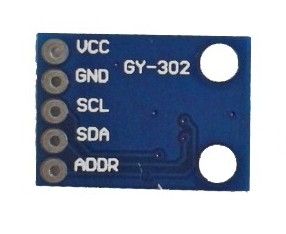 

### ML8511 UV senzor

UVA + UVB, 280–390 nm, rozsah 0–15 mW/cm², analogový výstup 1–3 V úměrný intenzitě, 300 µA. Napájení 2,7–3,6 V – na 5V Arduinu napájet z 3,3 V. Odkaz: [hadex.cz](https://www.hadex.cz/p/m541a-meric-senzor-uv-zareni-modul-s-ml8511).

| Parametr | Hodnota |
|---|---|
| Deska | 13 × 11 mm V |
| Díry | 1× Ø 3 mm, střed 2,5 mm shora a zleva M |

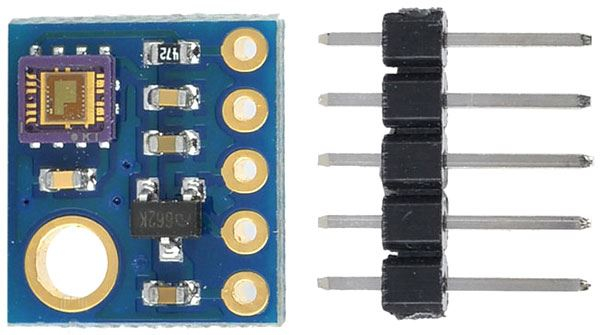

---

## Displeje

### OLED 0,96" 128×64 (SSD1306)

Bílý, I2C. Není to displej z projektu AS7262 (tam 1,3"). Odkaz: [AliExpress](https://www.aliexpress.com/item/32523790205.html).

| Parametr | Hodnota |
|---|---|
| Deska | 27 × 27,1 mm O |
| Výška bez kolíků | 4 mm M |
| Díry | 4× Ø 3 mm, rozteč 21 × 23 mm M |
| Aktivní plocha | 24,4 × 13,4 mm M (24,4 ve směru šířky desky), horní hrana 5 mm od horního okraje desky |
| Piny | GND, VDD, SCK, SDA |
| I2C | 0x3C (potisk 0x78/0x7A = 8bit zápis) |

 

### OLED 1,3" 128×64 (SH1106)

Bílý, I2C, použit v projektu AS7262. Provoz −20 až 70 °C. Prodejce uvádí aktivní plochu 29,42 × 14,7 mm; naměřených 34,5 × 19 mm je zřejmě celá viditelná plocha panelu včetně neaktivního okraje. Pro výřez okna platí naměřená hodnota, pro centrování obrazu údaj prodejce. Odkaz: [dratek.cz](https://dratek.cz/arduino-platforma/3181-iic-i2c-oled-1-3-displej-128x64-bily.html).

| Parametr | Hodnota |
|---|---|
| Deska | 36 × 34 mm M |
| Výška bez kolíků | 4,2 mm M |
| Díry | 4× Ø 3 mm, rozteč 30,5 × 28 mm, středy ~2,5 mm od okrajů M |
| Aktivní plocha | 34,5 × 19 mm M (34,5 ve směru šířky desky), horní hrana 5 mm od horního okraje desky |
| Piny | GND, VCC, SCK, SDA |
| I2C | 0x3C |

Soubory: [ukázka U8g2 HelloWorld](oled_130_sh1106/oled_130_u8g2_helloworld.ino) (aktivní konstruktor `U8G2_SH1106_128X64_NONAME_1_HW_I2C`), [návod Dratek](oled_130_sh1106/oled_130_navod_dratek.pdf).

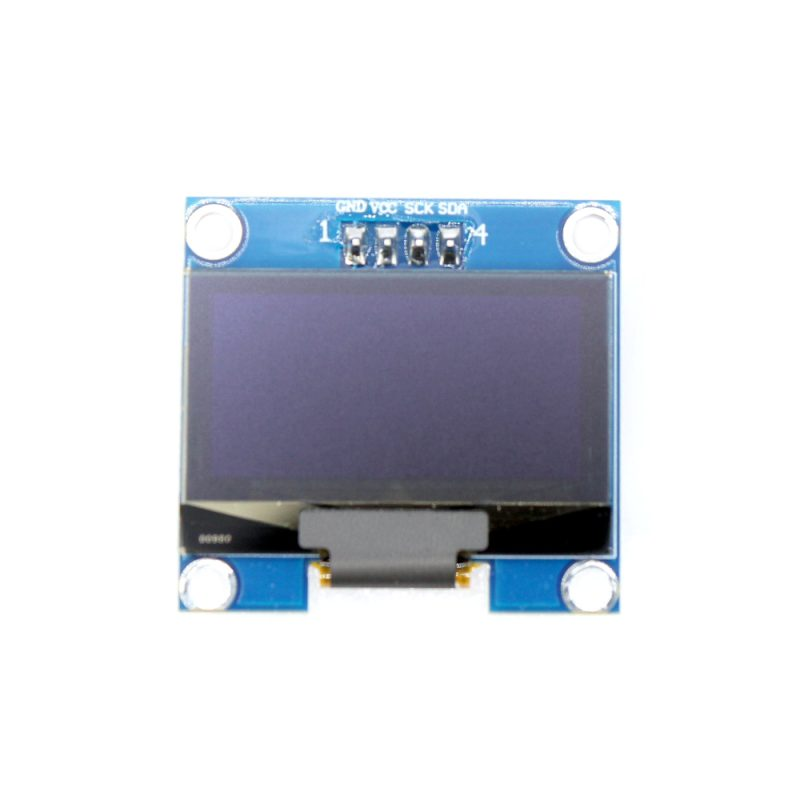 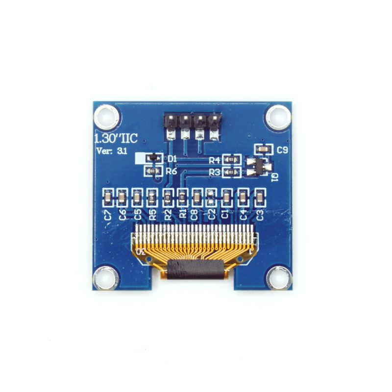

### TFT 2,8" IPS 240×320, kapacitní dotyk

SPI displej, kapacitní dotyk (CTP) po I2C, slot microSD. Potisk desky: „2.8" TFT SPI 240X320 V1.0". Položka „Color: 3.5 inch touch" na AliExpressu je chybná, deska je 2,8". Odkaz: [AliExpress](https://www.aliexpress.com/item/1005009266561335.html).

Parametry podle tabulky prodejce ([tft_28_foto2](tft_28_ips_touch/tft_28_foto2.avif)), ověřeno nebylo nic:

| Parametr | Hodnota (V) |
|---|---|
| SKU | MSP2834 (s dotykem), MSP2833 (bez) |
| Řadič displeje | ILI9341V, 4vodičové SPI; v popisu na webu uvedeno „ILI934Q" |
| Rozlišení, barvy | 240 × RGB × 320, 262K |
| Panel, podsvícení | IPS, 4× bílá LED, 280 cd/m² |
| Řadič dotyku | FT6336G, kapacitní, I2C |
| Napájení | 5,0 V; podsvícení 80 mA, příkon 0,4 W |
| Logika | převodník úrovní na desce, 3,3 V i 5 V MCU |
| Pin LED | řízení podsvícení přes tranzistor; nezapojený = podsvícení svítí (M 2026-11-14, pull-up na modulu odvozen z chování) |
| Rozměr modulu | 50,0 × 86,0 × 14,28 mm s dotykem včetně kolíků (bez dotyku 12,78 mm) |
| LCD / dotyková vrstva | 50,0 × 69,2 × 2,3 mm / 50,0 × 69,2 × 1,0 mm |
| Provozní teplota | −10 až 50 °C |

Délka 86 mm potvrzena měřením 2026-11-12; dřívější údaj 82 mm byl chybný.

| Parametr | Hodnota |
|---|---|
| Deska | 86 × 50 mm M |
| Výška bez kolíků | 9 mm M |
| Díry | 4× Ø 3 mm, rozteč 76 × 44 mm M; středy 2,5 mm od okrajů, na straně kolíků 6 mm M |
| Aktivní plocha | 58 × 44 mm M (58 podél delší strany), začíná 19 mm od strany s kolíky, v kratším rozměru na středu |

Doměřeno 2026-11-12: středy děr 7 mm od kratší hrany s kolíky, jinde 3 mm od hran (7 + 76 + 3 = 86 mm); sklo 4,5 mm nad lícem desky; slot microSD u delší hrany na straně pinu VCC, 36–53 mm od hrany s kolíky, karta 3 mm za hranou desky. Aktivní plocha odpovídá typickým 43,2 × 57,6 mm pro 2,8" 240×320.
| Piny (14) | VCC, GND, LCD_CS, LCD_RST, LCD_RS, SDI(MOSI), SCK, LED, SDO(MISO), CTP_SCL, CTP_RST, CTP_SDA, CTP_INT, SD_CS |

Soubory: [kótovaný výkres](tft_28_ips_touch/tft_28_foto3.avif) (tloušťky skla a modulu), [parametry](tft_28_ips_touch/tft_28_foto2.avif).

  

---

## Senzory prostředí a pohybu

### DS18B20 sonda 100 cm (MY18E20)

Vodotěsná nerezová sonda, 1-Wire, napájení 3,0–5,5 V, rozsah −55 až +125 °C, přesnost ±0,5 °C v rozsahu −10 až +85 °C. Vodiče: červený VCC, žlutý DATA, černý GND; na DATA pull-up 4,7 kΩ k VCC. Odkaz: [hadex.cz](https://www.hadex.cz/p/r255-teplotni-sonda-ds18b20-100cm-chip-my18e20).

| Parametr | Hodnota |
|---|---|
| Pouzdro senzoru | Ø 6 × 50 mm V |
| Kabel | 100 cm |

Soubory: [datasheet MY18E20](ds18b20_sonda/ds18b20_my18e20_datasheet.pdf). Fotografie chybí.

### SHT31-D (GY) teplota a vlhkost

Napájení 2,4–5,5 V, I2C, 16 bit, vlhkost 0–100 % (±2 %), teplota −40 až 125 °C (±0,3 °C). Odkaz: [hadex.cz](https://www.hadex.cz/p/m441q-teplotni-cidlo-a-vlhkomer-gy-sht31-d).

| Parametr | Hodnota |
|---|---|
| Deska | prodejce uvádí 12 × 10 × 4 mm – na fotografii je deska s 4 piny a otvorem 3 mm, údaj spíš neodpovídá desce, přeměřit |
| Díry | 1× Ø 3 mm v rohu, střed 2,5 / 2,5 mm od okrajů M |
| Piny | VIN, GND, SCL, SDA |
| I2C | 0x44 (ADR = L), 0x45 (ADR = H) |

Soubory: [datasheet SHT3x](sht31/sht31_datasheet.pdf).

 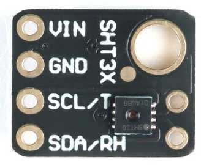

### AHT20 + BMP280 teplota, vlhkost, tlak

AHT20: teplota −40 až 85 °C (±0,3 °C), vlhkost 0–100 % (±2 %). BMP280: tlak 300–1100 hPa (±1 hPa), teplota ±1 °C. Napájení 3,3–5 V. V popisu prodejce chybně „ATH20". Odkaz: [hadex.cz](https://www.hadex.cz/p/m467a-teplomer-barometr-vlhkomer-ath20-bmp280).

| Parametr | Hodnota |
|---|---|
| Deska | 15 × 15 mm M |
| Díry | 2× Ø 2 mm, rozteč 11 mm, střed 7 mm od horního okraje M |
| Piny | VDD, SDA, GND, SCL |
| I2C | 0x38 (AHT20), 0x76 / 0x77 (BMP280) |

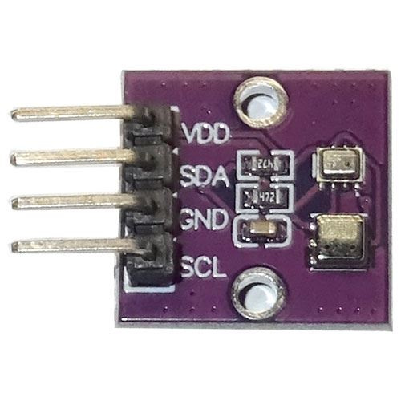 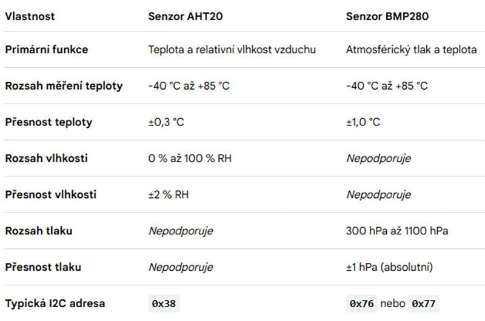

### MPU-6050 gyroskop + akcelerometr

3osý gyroskop (±250/500/1000/2000 °/s) a akcelerometr (±2/4/8/16 g), 16bit ADC, napájení 3–5 V, 3 g. Piny VCC, GND, SCL, SDA, XDA, XCL, AD0, INT. Odkazy: [dratek.cz](https://dratek.cz/arduino-platforma/830-iic-i2c-gyroskop-akcelerometr-modul-mpu-6050.html), [návod](https://navody.dratek.cz/navody-k-produktum/gyroskop-a-akcelerometr.html).

| Parametr | Hodnota |
|---|---|
| Deska | 21 × 15 × 1,2 mm V (1,2 mm = tloušťka DPS bez součástek) |
| Díry | 2× Ø 3 mm, rozteč 15 mm M |
| I2C | 0x68 (AD0 = L), 0x69 (AD0 = H) |

Soubory: [ukázkový kód](mpu6050/mpu6050_example.ino) (Adafruit MPU6050 2.2.1), [návod Dratek](mpu6050/mpu6050_navod_dratek.pdf).

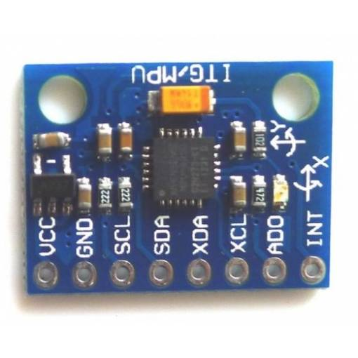

### INA228 monitor napětí, proudu a výkonu

Měření 0–36 V (bez záporného), proud ±20 A obousměrně (max. 10 A dle jiné části popisu), napájení 2,7–5,5 V, 16 adres volitelných pájecími propojkami A0/A1, výstup ALERT. Čip INA228 potvrzen (20bit ADC). Popis prodejce je zkopírován od INA226, údaje o rozlišení (16 bit, 1,25 mA / 1,25 mV) proto neplatí. Odkaz: [AliExpress](https://www.aliexpress.com/item/1005010509396623.html).

| Parametr | Hodnota |
|---|---|
| Deska | neuvedeno |
| Díry | Ø 3 mm, počet a rozteč neuvedeny |
| Piny | VCC, GND, SDA, SCL, ALERT; svorkovnice VIN+/VIN− (měřená větev) |
| I2C | 0x40–0x4F ([tabulka adres](ina228/ina228_foto2.avif)) |

 

### GPS GY-NEO6MV2

u-blox NEO-6M, keramická anténa na kabelu (u.FL), EEPROM, UART. Odkaz: [AliExpress](https://www.aliexpress.com/item/1005013030748828.html).

| Parametr | Hodnota |
|---|---|
| Deska | 36 × 27 mm M |
| Díry | 4× Ø 3 mm, rozteč 31 × 23 mm M |
| Piny | VCC, RX, TX, GND |

 

---

## Napájení

### TP4056 nabíječka Li-Ion, USB-C

TP4056 + DW01A + FS8205A. CC/CV 1 A do 4,2 V, rekondiční nabíjení 130 mA pod 2,9 V; ochrana proti hlubokému vybití (odpojení < 2,4 V, připojení > 3 V), nadproudu a zkratu (> 3 A). Vstup 4,5–6 V. LED: červená nabíjí, modrá nabito. Odkaz: [hadex.cz](https://www.hadex.cz/p/m401e-nabijecka-li-ion-clanku-1a-s-ochranou-modul-s-io-tp4056-usb-c).

| Parametr | Hodnota |
|---|---|
| Deska | 25 × 16,5 mm V; kótovaný obrázek 28 × 17,3 mm (pravděpodobně s USB-C) |
| Výška | 4 mm M |
| Díry | 4× Ø 1,5 mm v rozích, rozteč 23 × 14 mm M |

Soubory: [datasheet TP4056](tp4056_nabijecka/tp4056_datasheet.pdf).

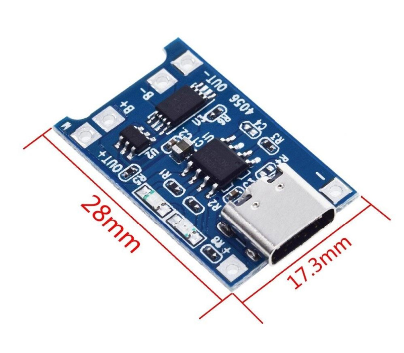

### MT3608 step-up 2 A

Neizolovaný DC-DC, vstup 2–24 V, výstup 2–24 V nastavitelný, 2 A max. (doporučeno do 1 A), účinnost 93 %. Napětí na vstupu nesmí převýšit nastavené výstupní. Před prvním použitím trimr vytočit naplno doleva (výstup ~24 V) a pak snižovat. Na vstup i výstup doporučen kondenzátor 2,2 µF. Odkaz: [hadex.cz](https://www.hadex.cz/p/m407-napajeci-modul-step-up-menic-2a-s-mt3608).

| Parametr | Hodnota |
|---|---|
| Deska | 36 × 17 × 14 mm V |
| Výška DPS se součástkami | 6,5 mm M (14 mm V zřejmě s trimrem) |
| Díry | 4× Ø 1,5 mm (pájecí pady VIN±/VOUT±), rozteč 34 × 6,4 mm M |

Soubory: [datasheet MT3608](mt3608_stepup/mt3608_datasheet.pdf).

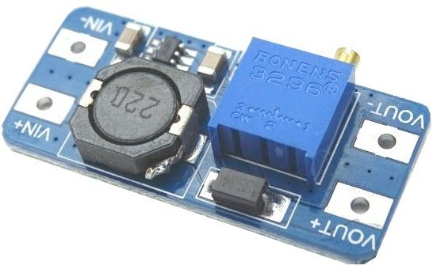

### LM2596 step-down 3 A

Neizolovaný DC-DC, vstup 4,5–35 V, výstup 3–33 V nastavitelný, 2 A (špičkově 3 A), max. 15 W, účinnost 92 %. Odkaz: [hadex.cz](https://www.hadex.cz/p/m406-napajeci-modul-step-down-menic-3a-s-lm2596-uin-max-35v).

| Parametr | Hodnota |
|---|---|
| Deska | 40 × 21,5 × 13,5 mm V |
| Díry | 2× Ø 3 mm (diagonálně), rozteč 33,5 mm, od okraje 8 × 2,5 mm M |

Soubory: [datasheet LM2596 (TI)](lm2596_stepdown/lm2596_datasheet_TI.pdf).

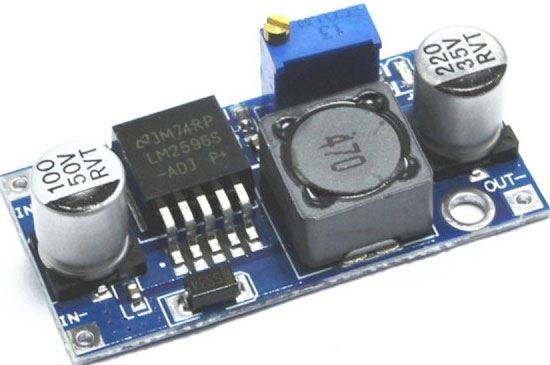 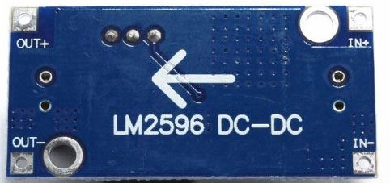

### Držák článku 18650 s vývody

Odkaz: [hadex.cz](https://www.hadex.cz/p/l038b-drzak-clanku-18650-s-vyvody).

| Parametr | Hodnota |
|---|---|
| Rozměry | 76 × 21 × 21 mm V |
| Upevnění | středový otvor na fotografii, rozměr neuveden |

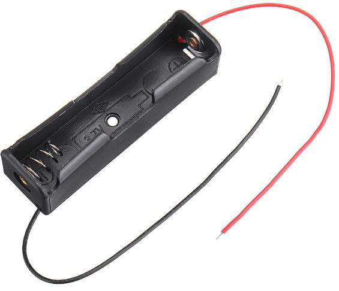

---

## Konstrukční a ovládací prvky

### Pájecí pole (část) 58 × 70

Odříznutá část desky 7 × 9 cm.

| Parametr | Hodnota |
|---|---|
| Rozměry | 58 × 70 mm M |
| Otvory | 18 × 24, rozteč 2,54 mm |
| Montážní díry | 2× Ø 3 mm, rozteč 65 mm M |

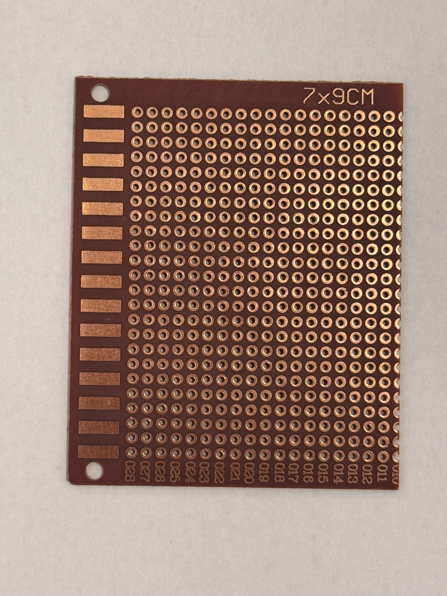

### Tlačítka 1×4 malá

4 nezávislá tlačítka, piny K1–K4 + GND (na straně MCU vstupy s INPUT_PULLUP). Odkaz: [AliExpress](https://www.aliexpress.com/item/1005012943047350.html).

| Parametr | Hodnota |
|---|---|
| Deska | 37,7 × 16 mm O |
| Díry | 4× Ø 3 mm, rozteč 33 × 11 mm M |

### Tlačítka 1×4 analogová, barevná

4 tlačítka na jednom analogovém výstupu (odporový dělič, každé tlačítko jiná hodnota), konektor PH2.0 3pin: G, V, S. Napájení 3,3–5,5 V. Odkaz: [AliExpress](https://www.aliexpress.com/item/1005010585611497.html).

| Parametr | Hodnota |
|---|---|
| Deska | 77 × 18 × 14 mm V (výška s hmatníky) |
| Díry | Ø 3 mm, rozteč 62 × 10 mm M (prodejce: 10 mm) |

Soubory: [výkres DPS](tlacitka_1x4_analog/tlacitka_1x4_analog_foto1.avif).

 

### Tlačítka 2×2 matice (KeyPad 22 V100)

Matice 2 řádky × 2 sloupce, piny L1, L2, R1, R2. Odkaz: [dratek.cz](https://dratek.cz/arduino-platforma/7720-modul-klavesnice-matice-2-x-2-tlacitka.html).

| Parametr | Hodnota |
|---|---|
| Deska | 25 × 20 mm M |
| Díry | 4×, průměr neuveden, rozteč 14 × 19 mm M |

Soubory: [ukázkový kód](tlacitka_2x2/tlacitka_2x2_example.ino) (knihovna Keypad), [návod Dratek](tlacitka_2x2/tlacitka_2x2_navod_dratek.pdf).

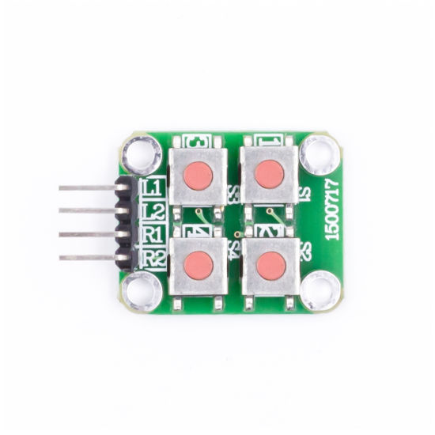 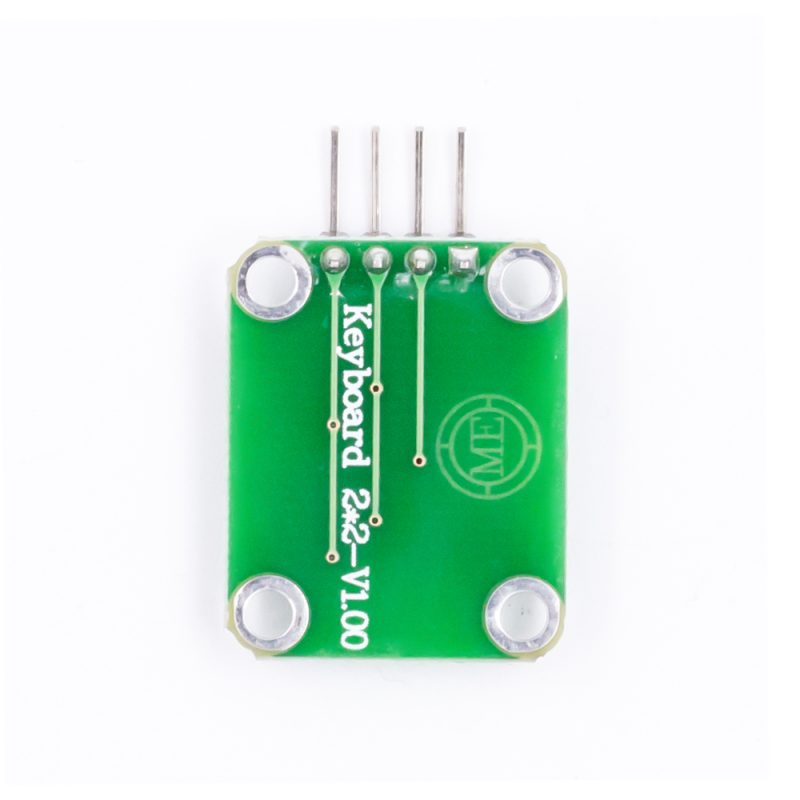

### Joystick 5směrný + SET + RST

Navigační modul: UP, DWN, LFT, RHT, MID, SET, RST + COM (7 vstupů). Prodejce uvádí napájení 2,0–9,0 V; jde o pasivní tlačítka, COM připojit na GND nebo VCC podle zvolených pull-upů. Odkaz: [AliExpress](https://www.aliexpress.com/item/32954285784.html).

| Parametr | Hodnota |
|---|---|
| Deska | 25 × 41 mm M = V |
| Díry | 4× Ø 4 mm, rozteč 18 × 24 mm M |

   

---

## Co chybí

Výška (osa z) včetně kolíků a konektorů je pro návrh krabičky nejdůležitější chybějící údaj; změřena je jen u displejů, TP4056 a MT3608. Stejně tak poloha děr vůči okraji (ne jen rozteč) je uvedena pouze u AS7341, AS7262, BH1750, AHT20, SHT31, ML8511, LM2596 a displejů.

| Modul | Chybí |
|---|---|
| Arduino Nano | potvrdit, které kusy jsou Nano; fotografie, pinout, změřený rozměr klonu, výška s USB-C |
| Arduino Pro Micro | potvrdit přiřazení fotografií a rozměru ke kusu, napěťovou verzi (propojka 5V/3.3V), výšku |
| ESP32 DevKit | pinout (GPIO, ADC2 nepoužitelné s Wi-Fi), poloha děr od okraje, výška |
| ESP32 Wemos D1 R32 | ověření děr podle souřadnic UNO, pinout |
| AS7262 | výška Qwiic konektorů |
| OLED 0,96" | ukázkový kód |
| TFT 2,8" | ověřit napájení 3,3 V a čtení SD karty; ukázkový kód je v `esp32_nes_handheld/firmware/test_display` |
| DS18B20 | fotografie, ukázkový kód (OneWire + DallasTemperature) |
| SHT31-D | skutečný rozměr desky, ukázkový kód |
| AHT20 + BMP280 | ukázkový kód, datasheety |
| ML8511 | datasheet, ukázkový kód (přepočet napětí na mW/cm²) |
| MPU-6050 | datasheet čipu |
| INA228 | rozměr desky, díry, hodnota bočníku, datasheet, ukázkový kód |
| GPS NEO-6M | rozměr antény (25 × 25 mm?) a délka kabelu, datasheet, ukázkový kód (TinyGPS++) |
| TP4056 | potvrzení, zda 28 mm zahrnuje USB-C |
| MT3608 | výška s trimrem |
| LM2596 | výška s kondenzátory (13,5 V neověřeno) |
| Držák 18650 | rozměr a poloha upevňovacího otvoru |
| Tlačítka 2×2 | průměr děr, výška hmatníků |
| Tlačítka 1×4 | výška hmatníků nad DPS |
| Joystick | výška páčky nad DPS |
